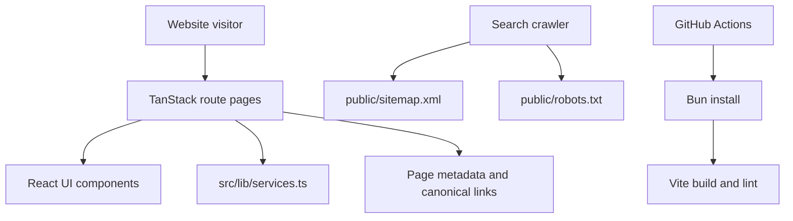

# Architecture

## Overview

Qafri is a React and TypeScript travel-services website using TanStack Router / TanStack Start with Vite and Bun.

## Service page data flow

`src/routes/services.$slug.tsx` loads the matching service from `src/lib/services.ts`, displays its details, and generates page metadata and a canonical URL using its slug. Invalid service slugs are handled as not found.

## Sitemap ownership

`public/sitemap.xml` is the sole sitemap asset. It must be kept in sync with service slugs in `src/lib/services.ts`. Avoid a second server route for `/sitemap.xml` because it creates ambiguous delivery paths.

## Boundaries and assumptions

This document describes the repository source. It does not claim to verify production DNS, hosting bindings, third-party form delivery, server-side secrets or a successful deployed build. Confirm these separately during release verification.
